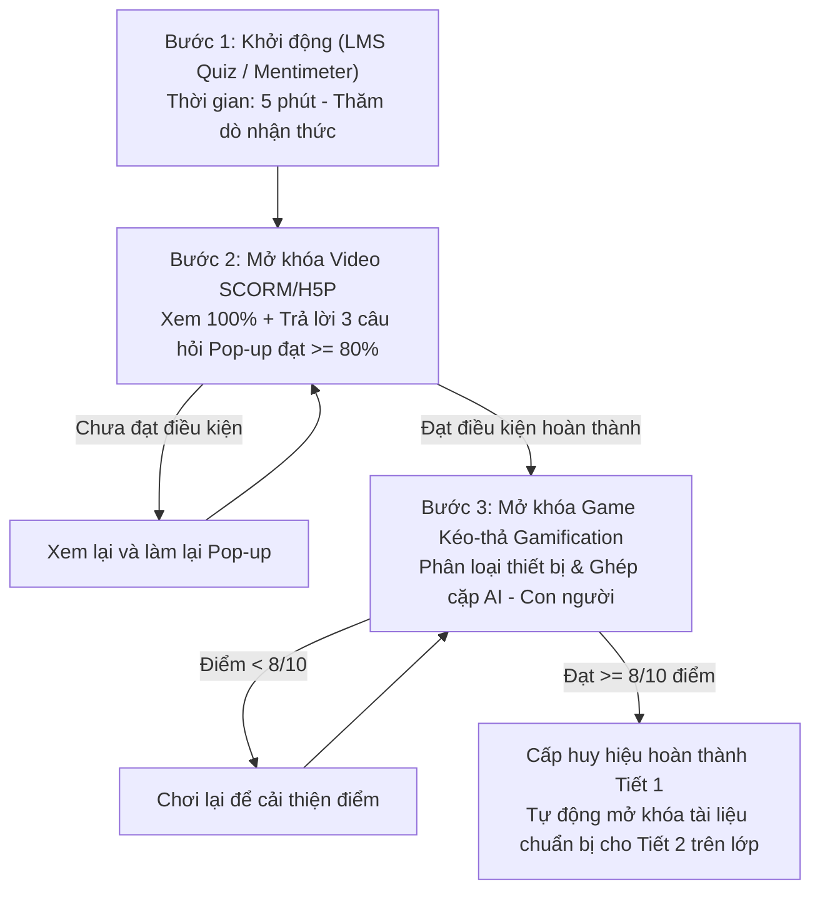

# BỘ HỌC LIỆU TRỰC TUYẾN TRÊN HỆ THỐNG LMS (TIẾT 1)
**MÔN:** TIN HỌC 6 - CHUYÊN ĐỀ TRÍ TUỆ NHÂN TẠO  
**BÀI 1:** NGUỒN GỐC CỦA AI VÀ QUYỀN QUYẾT ĐỊNH (Mức Hiểu và Vận dụng)  
**THỜI LƯỢNG TIẾT 1:** 45 PHÚT (HỌC TRỰC TUYẾN QUA HỆ THỐNG LMS)  
*Căn cứ thiết kế: Kế hoạch bài dạy (KHBD) Bài 1 & Khung năng lực số/AI (UNESCO AI CFT, US Dept of Ed)*

---

## MỤC LỤC BỘ HỌC LIỆU
1. **Học liệu 1: Cụm câu hỏi khảo sát ngắn khởi động (LMS Quiz / Survey / Mentimeter)**
2. **Học liệu 2: Kịch bản Video học tập tương tác SCORM / H5P / Edpuzzle (Kèm câu hỏi neo chặn Pop-up)**
3. **Học liệu 3: Bộ bài tập trò chơi hóa (Gamification) Kéo - Thả Drag & Drop (Wordwall / H5P)**
4. **Hướng dẫn tích hợp kỹ thuật lên hệ thống LMS (Moodle, Canvas, K12Online, Google Classroom)**

---

# PHẦN 1: CỤM CÂU HỎI KHẢO SÁT NGẮN KHỞI ĐỘNG (HOẠT ĐỘNG 1 - 5 PHÚT)

* **Mục tiêu sư phạm:** Khơi gợi sự tò mò, kích hoạt kiến thức nền (prior knowledge), thăm dò nhận thức ban đầu của học sinh lớp 6 về nguồn gốc AI trước khi tiếp cận kiến thức mới.
* **Thời gian thực hiện:** 5 phút đầu tiết học (không đồng bộ hoặc mở đầu buổi học trực tuyến).
* **Công cụ triển khai:** Nhúng trực tiếp vào LMS bằng Quiz/Survey của LMS hoặc Mentimeter/Google Forms qua mã Iframe.

---

### CÂU HỎI 1: KHẢO SÁT VỀ NGUỒN GỐC CỦA TRÍ TUỆ NHÂN TẠO
* **Dạng câu hỏi:** Trắc nghiệm 1 lựa chọn (Single Choice Poll / Multiple Choice).
* **Tiêu đề câu hỏi:** *"Theo em, Trí tuệ nhân tạo (AI) tự sinh ra trong tự nhiên hay do con người tạo ra?"*
* **Các phương án lựa chọn:**
  - **A.** AI tự sinh ra và tự tiến hóa trong tự nhiên giống như muông thú, cây cỏ.
  - **B.** AI do con người thu thập dữ liệu, lập trình thuật toán và huấn luyện máy tính tạo ra. *(Phương án cốt lõi)*
  - **C.** AI do các siêu robot ngoài không gian mang đến trái đất.
  - **D.** AI tự xuất hiện khi máy tính và mạng Internet được cắm điện.
* **Phản hồi tự động (Automated Feedback) hiển thị trực tiếp khi học sinh chọn:**
  - *Nếu chọn B (Đúng):* "🎯 **ĐÚNG RỒI!** Trí tuệ nhân tạo (AI) hoàn toàn không tự sinh ra trong tự nhiên, mà do con người dày công thu thập dữ liệu, viết thuật toán và huấn luyện máy tính tạo nên."
  - *Nếu chọn A, C hoặc D (Chưa đúng):* "❌ **CHƯA CHÍNH XÁC!** AI không tự sinh ra và không có sẵn trong tự nhiên. AI thực chất là sản phẩm do con người trực tiếp thu thập dữ liệu, lập trình thuật toán và điều khiển. Em hãy chọn lại phương án đúng nhé!"

---

### CÂU HỎI 2: KHẢO SÁT TRẢI NGHIỆM THỰC TẾ CỦA HỌC SINH
* **Dạng câu hỏi:** Đám mây từ khóa (Word Cloud) hoặc Câu hỏi mở trả lời ngắn (Short Answer).
* **Tiêu đề câu hỏi:** *"Hãy kể tên 1 ứng dụng, thiết bị hoặc tính năng thông minh có Trí tuệ nhân tạo (AI) mà em hoặc người thân từng sử dụng hay từng nghe nói đến!"*
* **Định dạng hiển thị:** Ô nhập văn bản (tối đa 30 ký tự, mỗi học sinh có thể nhập 1-3 từ khóa).
* **Gợi ý từ khóa cho học sinh yếu/trung bình:** 
  - *Gợi ý 1:* Nhận diện khuôn mặt (FaceID trên điện thoại).
  - *Gợi ý 2:* Google Dịch (Google Translate).
  - *Gợi ý 3:* Trợ lý ảo Siri, Google Assistant.
  - *Gợi ý 4:* Chatbot (ChatGPT, Gemini).
  - *Gợi ý 5:* Robot hút bụi thông minh trong nhà.
  - *Gợi ý 6:* Đề xuất video trên YouTube / TikTok.
* **Mục đích thu thập:** Tạo đám mây từ khóa trực quan trên bảng điều khiển LMS của giáo viên, làm ngữ liệu sinh động để dẫn dắt vào bài giảng Hoạt động 2.

---

### MÃ NHÚNG IFRAME MẪU VÀO LMS
```html
<!-- Mã nhúng khảo sát khởi động (Mentimeter / LMS Widget) -->
<div class="embed-survey-container" style="position: relative; padding-bottom: 56.25%; height: 0; overflow: hidden; max-width: 100%; border-radius: 12px; box-shadow: 0 4px 12px rgba(0,0,0,0.1);">
  <iframe 
    src="https://www.mentimeter.com/app/presentation/embed/YOUR_PRESENTATION_ID" 
    style="position: absolute; top: 0; left: 0; width: 100%; height: 100%; border: 0;" 
    allowfullscreen="true" 
    title="Khảo sát khởi động: Nguồn gốc AI">
  </iframe>
</div>
```

---

# PHẦN 2: KỊCH BẢN VIDEO HỌC TẬP TƯƠNG TÁC (HOẠT ĐỘNG 2.1 - 20 PHÚT)
**Chuẩn công nghệ:** SCORM 1.2 / 2004 hoặc H5P Interactive Video / Edpuzzle  
**Thời lượng video:** 5 phút 30 giây (Phù hợp tâm sinh lý lứa tuổi học sinh lớp 6)  
**Tiêu chí hoàn thành (Completion Rule):** Xem tối thiểu 100% thời lượng video, trả lời đúng các câu hỏi neo chặn (Pop-up checkpoints) đạt từ 80% điểm trở lên. Không cho phép tua lướt (Disable skipping).  
**Link video gốc (YouTube):** [https://youtu.be/M5xe04_4YrU?si=zC9vQX8oAFUa5d7v](https://youtu.be/M5xe04_4YrU?si=zC9vQX8oAFUa5d7v)

---

## 1. KỊCH BẢN PHÂN CẢNH VÀ LỜI THOẠI (STORYBOARD)

| Mốc thời gian | Phân cảnh hình ảnh / Video trực quan | Lời thuyết minh (Audio Voice-over) | Yếu tố sư phạm & Minh chứng |
| :--- | :--- | :--- | :--- |
| **00:00 - 00:45** | **Cảnh 1: Đặt vấn đề - AI có phải phép màu?**<br>- Robot biến hình trong phim viễn tưởng.<br>- Cảnh học sinh đang nói chuyện với Siri trên iPhone và máy quét khuôn mặt mở cổng trường. | "Chào các em học sinh lớp 6 thân mến! Chắc hẳn các em đã quen thuộc với những chú robot thông minh trong phim hoạt hình hay những trợ lý ảo có thể trả lời mọi thắc mắc. Nhiều người nghĩ AI thông minh như vậy thì chắc là tự sinh ra từ vũ trụ, hoặc máy tính tự thông minh lên. Liệu có đúng như vậy không? Hôm nay, chúng ta sẽ cùng giải mã bí ẩn: AI thực sự từ đâu mà có?" | Kích hoạt tò mò, xóa bỏ lầm tưởng về AI viễn tưởng. |
| **00:46 - 01:45** | **Cảnh 2: Bản chất của AI - Human-led (Con người dẫn dắt)**<br>- Hình ảnh các kỹ sư công nghệ đang làm việc bên máy tính.<br>- Đồ họa: Bộ não người phát sáng, truyền tín hiệu chỉ dẫn sang hệ thống máy tính. | "Sự thật là: Trí tuệ nhân tạo (AI) hoàn toàn không tự sinh ra trong tự nhiên, và máy móc cũng không thể tự nghĩ ra trí thông minh. Theo UNESCO, AI là công nghệ 'Human-led' - nghĩa là **do con người dẫn dắt**! AI chỉ là một chương trình máy tính do con người lập trình và huấn luyện để giải quyết những bài toán cụ thể phục vụ đời sống." | Bám sát tài liệu UNESCO AI CFT (Human-led design). |
| **01:45** | **[POP-UP 1: CÂU HỎI NEO CHẶN SỐ 1 XUẤT HIỆN]**<br>*(Video tự động dừng lại. Học sinh bắt buộc phải trả lời đúng mới được mở khóa xem tiếp).* | *(Xem chi tiết câu hỏi Pop-up 1 bên dưới)* | Kiểm tra mức độ ghi nhớ và hiểu khái niệm Human-led. |
| **01:46 - 03:15** | **Cảnh 3: Quy trình 3 bước con người tạo ra AI**<br>- Đồ họa chuyển động 3 giai đoạn:<br>1. *Dữ liệu (Data):* Hàng ngàn bức ảnh mèo/chó.<br>2. *Thuật toán (Algorithms):* Các công thức logic.<br>3. *Huấn luyện & Kiểm thử (Training).* | "Vậy làm sao con người biến chiếc máy tính vô tri thành AI? Hãy xem quy trình 3 bước sau:<br>- **Bước 1: Con người thu thập dữ liệu.** Ví dụ muốn dạy AI nhận diện quả cam, con người phải chụp hàng triệu bức ảnh quả cam đủ màu sắc, góc chụp.<br>- **Bước 2: Con người viết thuật toán.** Đây là những công thức toán và quy tắc logic do các kỹ sư viết ra để chỉ dẫn máy tính tìm điểm chung.<br>- **Bước 3: Con người huấn luyện và kiểm duyệt.** Con người cho máy học, kiểm tra xem máy đoán đúng hay sai và sửa lỗi cho máy." | Minh chứng UNESCO AI CFT (Data collection & Algorithm design by humans). |
| **03:15** | **[POP-UP 2: CÂU HỎI NEO CHẶN SỐ 2 XUẤT HIỆN]**<br>*(Video tự động dừng lại. Kiểm tra quy trình tạo ra AI).* | *(Xem chi tiết câu hỏi Pop-up 2 bên dưới)* | Đánh giá năng lực tư duy logic và quy trình kỹ thuật. |
| **03:16 - 04:30** | **Cảnh 4: AI không thể tự làm chủ - Luôn cần con người (Human oversight)**<br>- Cảnh minh họa: Người thợ dùng chiếc búa thông minh hoặc người đi xe đạp trợ lực điện.<br>- Tình huống lỗi: AI nhận diện một chiếc bánh muffin có đốm đen thành chú chó đốm Chihuahua! | "AI có thể nhận diện hình ảnh rất nhanh, nhưng nó không có ý thức. Nhìn bức ảnh này xem: AI có thể nhầm lẫn chiếc bánh muffin nho với một chú chó Chihuahua con! Vì thế, máy móc không thể tự chịu trách nhiệm. Con người luôn phải là người giám sát, kiểm tra và đưa ra quyết định cuối cùng khi sử dụng AI." | Khái niệm Human oversight & Human accountability. |
| **04:30** | **[POP-UP 3: CÂU HỎI NEO CHẶN SỐ 3 XUẤT HIỆN]**<br>*(Video tự động dừng lại. Câu hỏi phản biện xử lý tình huống).* | *(Xem chi tiết câu hỏi Pop-up 3 bên dưới)* | NLa (1): Hiểu vai trò quyết định của con người. |
| **04:31 - 05:30** | **Cảnh 5: Tổng kết bài học và chuẩn bị cho Hoạt động 2.2**<br>- Bản đồ tư duy tóm tắt 3 ý cốt lõi.<br>- Lời kêu gọi hành động tham gia mini game. | "Tóm lại, qua bài học hôm nay các em hãy ghi nhớ 2 thông điệp vàng:<br>1. AI do con người tạo ra, lập trình và dạy dỗ, không tự sinh ra!<br>2. Con người nắm giữ quyền quyết định và chịu trách nhiệm khi sử dụng AI.<br>Bây giờ, hãy tự tin bước sang Hoạt động 2.2 để tham gia trò chơi phân loại 'AI quanh ta' nhé! Chúc các em đạt điểm tuyệt đối!" | Củng cố và chuyển giao nhiệm vụ tiếp theo. |

---

## 2. BỘ CÂU HỎI NEO CHẶN (IN-VIDEO INTERACTIVE POP-UP QUESTIONS)

### POP-UP 1 (Xuất hiện tại thời điểm 01:45)
* **Hình thức:** Multiple Choice (Trắc nghiệm 4 lựa chọn).
* **Nội dung câu hỏi:**  
  *"Tại sao tài liệu quốc tế khẳng định Trí tuệ nhân tạo (AI) là công nghệ do con người dẫn dắt (Human-led)?"*
* **Các phương án:**
  - A. Vì AI có thể tự học mọi thứ mà không cần ai dạy.
  - B. Vì AI hoàn toàn do con người thu thập dữ liệu, lập trình thuật toán và điều khiển mục đích sử dụng. **(ĐÁP ÁN ĐÚNG)**
  - C. Vì con người chỉ đứng nhìn khi AI tự sáng tạo ra thế giới mới.
  - D. Vì AI tự sinh ra từ dây cáp và mạch điện trong máy vi tính.
* **Cài đặt tương tác (H5P / Edpuzzle Behavior):**
  - *Nếu chọn ĐÚNG (B):* Cộng 10 điểm, hiển thị lời khen: "Chính xác tuyệt đối! Con người luôn là chủ thể tạo ra và định hướng cho AI hoạt động." -> Tự động chạy tiếp video.
  - *Nếu chọn SAI (A, C, D):* Hiển thị cảnh báo: "Chưa chính xác! AI không tự sinh ra và không tự làm được gì nếu không có con người lập trình." -> **Tự động tua lại video về mốc 00:50** để học sinh nghe lại kiến thức trước khi làm lại.

---

### POP-UP 2 (Xuất hiện tại thời điểm 03:15)
* **Hình thức:** Sắp xếp thứ tự các bước (Sequencing / Ordering Question).
* **Nội dung câu hỏi:**  
  *"Em hãy sắp xếp đúng thứ tự 3 bước cơ bản mà con người thực hiện để tạo ra một hệ thống AI nhận diện giọng nói:"*
* **Các bước cần sắp xếp:**
  - `Bước 1`: Con người thu âm và xử lý hàng triệu tệp âm thanh giọng nói mẫu (Thu thập dữ liệu).
  - `Bước 2`: Kỹ sư viết thuật toán phân tích sóng âm và trích xuất đặc trưng giọng nói (Thiết kế thuật toán).
  - `Bước 3`: Cài đặt vào điện thoại, kiểm tra thử nghiệm và hiệu chỉnh độ chính xác (Triển khai & Kiểm thử).
* **Đáp án đúng:** Thứ tự chuẩn: Bước 1 -> Bước 2 -> Bước 3.
* **Cài đặt tương tác:**
  - Cho phép học sinh kéo thả các khối hộp để đổi thứ tự.
  - Phản hồi giải thích: "Rất chuẩn! Con người phải có 'nguyên liệu' (dữ liệu), sau đó có 'công thức' (thuật toán), cuối cùng mới 'kiểm tra sản phẩm' (huấn luyện/kiểm thử)."

---

### POP-UP 3 (Xuất hiện tại thời điểm 04:30)
* **Hình thức:** Trắc nghiệm tình huống phản biện (Case-based Multiple Choice).
* **Nội dung câu hỏi:**  
  *"Khi một ứng dụng AI nhận diện nhầm hình ảnh chiếc bánh muffin thành chú chó con, nguyên nhân gốc rễ là gì và ai là người chịu trách nhiệm khắc phục?"*
* **Các phương án:**
  - A. Do ứng dụng AI cố tình trêu đùa con người; lỗi hoàn toàn thuộc về chiếc điện thoại.
  - B. Do con người chưa cung cấp đủ dữ liệu đa dạng hoặc thuật toán chưa hoàn thiện; kỹ sư con người phải chịu trách nhiệm nâng cấp và sửa lỗi. **(ĐÁP ÁN ĐÚNG)**
  - C. Không có ai có lỗi cả vì máy móc có quyền tự do quyết định kết quả nhận diện.
  - D. Do chiếc bánh muffin tự biến đổi thành con chó khi chụp ảnh.
* **Cài đặt tương tác:**
  - *Phản hồi đúng:* "Xuất sắc! Máy móc không có ý thức hay cảm xúc. Mọi sai sót của AI đều bắt nguồn từ hạn chế trong dữ liệu hoặc thuật toán do con người thiết kế. Con người phải luôn giám sát và chịu trách nhiệm!"

---

## 3. THÔNG SỐ CẤU HÌNH GÓI SCORM / H5P TRÊN LMS
- **Passing Score (Điểm đạt):** 80% (Học sinh đạt 80/100 điểm trắc nghiệm neo chặn mới tính là hoàn thành).
- **Navigation Controls:** 
  - Khóa thanh trượt (Prevent scrubbing / Forward navigation disabled).
  - Cho phép tua lùi để nghe lại kiến thức (Rewind enabled).
- **Activity Completion (Điều kiện hoàn thành hoạt động trên LMS):**
  - [x] Học sinh phải xem đạt 100% video.
  - [x] Học sinh phải hoàn thành tất cả các câu hỏi neo chặn và đạt điểm tối thiểu 80%.
  - [x] Tự động đẩy điểm vào cột điểm LMS Gradebook.

---

# PHẦN 3: BÀI TẬP TRÒ CHƠI HÓA (GAMIFICATION) KÉO - THẢ (HOẠT ĐỘNG 2.2 - 20 PHÚT)
**Nền tảng thực thi:** Wordwall (Dạng Nhóm phân loại - Group Sort & Cặp đôi ghép nối - Matching Pairs) hoặc H5P Drag & Drop.  
**Thời gian tham gia:** 20 phút.  
**Cơ chế Gamification:** Tính giờ đếm ngược, âm thanh hiệu ứng chúc mừng khi ghép đúng, âm thanh "buzz" nhẹ khi ghép sai kèm hiệu ứng rung lắc (shake), bảng xếp hạng lớp (Leaderboard).  
**Điều kiện qua bài (Pass condition):** Tối thiểu 8/10 điểm (80%). Cho phép chơi lại nhiều lần đến khi thành thạo.

---

## NHIỆM VỤ 1: TRÒ CHƠI PHÂN LOẠI "CÓ ỨNG DỤNG AI" HAY "KHÔNG DÙNG AI"
* **Đề bài hiển thị:** *"Em hãy kéo từng thẻ thiết bị/ứng dụng dưới đây và thả vào đúng chiếc hộp: 'HỘP CÓ ỨNG DỤNG AI' hoặc 'HỘP KHÔNG DÙNG AI'!"*
* **Số lượng thẻ:** 10 thẻ đồ họa tương tác.

### BẢNG ĐẶC TẢ CHI TIẾT 10 THẺ KÉO - THẢ:

| STT | Tên thẻ kéo | Hình ảnh minh họa | Hộp đích (Phân loại đúng) | Giải thích sư phạm (Hiển thị khi HS bấm xem lời giải) |
| :---: | :--- | :--- | :---: | :--- |
| **1** | Mở khóa điện thoại bằng FaceID | Biểu tượng quét khuôn mặt 3D phát sáng | **CÓ ỨNG DỤNG AI** | Sử dụng học máy (Machine Learning) để nhận diện đường nét khuôn mặt người dùng dù có đeo kính hay đội mũ. |
| **2** | Máy tính bỏ túi cầm tay (Casio fx-580VN) | Hình ảnh máy tính bỏ túi học sinh | **KHÔNG DÙNG AI** | Chỉ thực hiện các phép toán số học cộng trừ nhân chia cố định đã được nạp sẵn vào chip vi xử lý, không có khả năng tự học từ dữ liệu. |
| **3** | Google Dịch (Google Translate) | Biểu tượng hai ngôn ngữ chuyển đổi | **CÓ ỨNG DỤNG AI** | Áp dụng công nghệ Xử lý ngôn ngữ tự nhiên (NLP) để hiểu ngữ cảnh câu và dịch tự động giữa các ngôn ngữ. |
| **4** | Quạt máy bấm phím cơ số 1, 2, 3 | Cây quạt đứng có phím bấm cơ học | **KHÔNG DÙNG AI** | Thiết bị điện cơ đơn thuần: khi bấm nút thì dòng điện qua các mức điện trở khác nhau để đổi tốc độ quay, hoàn toàn không có trí tuệ hay dữ liệu. |
| **5** | Trợ lý giọng nói Siri / Google Assistant | Biểu tượng micrô sóng âm đầy màu sắc | **CÓ ỨNG DỤNG AI** | Ứng dụng AI nhận dạng giọng nói con người, chuyển thành văn bản và phân tích ý định người dùng để trả lời. |
| **6** | Chiếc đồng hồ báo thức cơ học | Hình ảnh đồng hồ chuông gõ kim loại | **KHÔNG DÙNG AI** | Hoạt động hoàn toàn bằng hệ thống dây cót, bánh răng cơ học định giờ, không có bất kỳ thuật toán AI nào. |
| **7** | YouTube tự đề xuất video em yêu thích | Màn hình gợi ý danh sách phát YouTube | **CÓ ỨNG DỤNG AI** | Thuật toán học máy phân tích lịch sử xem của em để dự đoán và đề xuất những video phù hợp với sở thích. |
| **8** | Bàn phím máy tính thông thường | Bàn phím bấm máy vi tính | **KHÔNG DÙNG AI** | Thiết bị phần cứng ngoại vi dùng để nhập liệu cơ học, truyền tín hiệu phím bấm vào máy tính. |
| **9** | Hộp thư Gmail tự lọc Email rác (Spam) | Biểu tượng phong bì thư bị chặn | **CÓ ỨNG DỤNG AI** | Hệ thống AI học hỏi từ hàng triệu email để nhận biết từ ngữ lừa đảo, virus và tự động đưa vào thùng rác. |
| **10** | Đèn pin cầm tay bật bằng công tắc trượt | Cây đèn pin chiếu ánh sáng | **KHÔNG DÙNG AI** | Đóng/ngắt mạch điện cơ bản bằng công tắc vật lý để thắp sáng bóng đèn LED, không có xử lý thông tin. |

---

## NHIỆM VỤ 2: TRÒ CHƠI GHÉP NỐI "CÔNG CỤ AI" VÀ "HÀNH ĐỘNG CỦA CON NGƯỜI"
* **Đề bài hiển thị:** *"Hãy kéo mỗi Công cụ AI ở Cột A ghép nối với Hành động tương ứng của Con người ở Cột B để chứng minh: Bất kỳ công cụ AI nào cũng do con người dày công tạo dựng!"*
* **Số lượng cặp ghép:** 5 cặp kiến thức trọng tâm.

### BẢNG ĐẶC TẢ 5 CẶP GHÉP NỐI:

| Cặp | CỘT A: CÔNG CỤ TRÍ TUỆ NHÂN TẠO | CỘT B: HÀNH ĐỘNG DO CON NGƯỜI THỰC HIỆN | Ý nghĩa bản chất sư phạm |
| :---: | :--- | :--- | :--- |
| **Cặp 1** | **Trợ lý ảo giọng nói trên điện thoại** | **Con người thu âm và gắn nhãn hàng triệu tệp âm thanh giọng nói mẫu của đủ mọi vùng miền.** | AI không tự biết tiếng người; con người phải cung cấp dữ liệu giọng nói khổng lồ để máy học phát âm. |
| **Cặp 2** | **Camera tự động quét nhận diện biển số xe** | **Kỹ sư con người viết thuật toán phân tích hình ảnh để bóc tách các ký tự chữ số từ bức ảnh chụp.** | Thuật toán nhận diện là do kỹ sư con người thiết kế và lập trình từng dòng lệnh logic. |
| **Cặp 3** | **Xe tự lái nhận biết biển báo giao thông** | **Con người chụp và nạp vào máy tính hàng ngàn hình ảnh biển báo dưới trời mưa, nắng, ban đêm.** | Dữ liệu đào tạo xe tự lái là do con người vất vả đi chụp và gán nhãn từng biển báo cấm, biển chỉ dẫn. |
| **Cặp 4** | **Phần mềm dự báo thời tiết bằng AI** | **Các nhà khoa học thu thập dữ liệu áp suất, độ ẩm từ vệ tinh và xây dựng mô hình tính toán khí hậu.** | AI không tự nhìn trời đoán mưa; nó dựa vào dữ liệu khí tượng và công thức mô phỏng của các nhà khoa học. |
| **Cặp 5** | **Ứng dụng vẽ tranh tự động bằng AI (Midjourney)** | **Con người số hóa hàng triệu bức tranh của các họa sĩ qua nhiều thế kỷ làm kho dữ liệu cho máy học phong cách vẽ.** | AI không có cảm hứng nghệ thuật; nó chỉ tổng hợp lại các đường nét, màu sắc từ dữ liệu tranh của các họa sĩ con người. |

---

## CẤU HÌNH GAMIFICATION & THIẾT LẬP KỸ THUẬT CHO WORDWALL / H5P
1. **Thiết lập bảng điều khiển trò chơi:**
   - Thời gian đếm ngược: 5 phút cho Nhiệm vụ 1; 5 phút cho Nhiệm vụ 2.
   - Số lượt thử (Lives): Không giới hạn (Unlimited attempts) nhằm khuyến khích học sinh tự học, tự sửa sai.
   - Hiệu ứng phản hồi: Âm thanh chúc mừng (Chime) khi xếp đúng, âm cảnh báo nhẹ khi xếp sai.
2. **Quy tắc tính điểm & Ghi nhận LMS:**
   - Mỗi thẻ phân loại đúng: 1 điểm (Tổng 10 điểm cho NV1).
   - Mỗi cặp ghép nối đúng: 2 điểm (Tổng 10 điểm cho NV2).
   - **Điểm đạt (Pass Rule):** Học sinh phải đạt từ **8/10 điểm trở lên** ở mỗi nhiệm vụ mới được hệ thống LMS cấp dấu tích xanh hoàn thành (Activity Completion) và mở khóa bài học Tiết 2.

### MÃ NHÚNG WORDWALL MẪU TRÊN LMS:
```html
<!-- Mã nhúng bài tập Wordwall Hoạt động 2.2 -->
<div class="wordwall-embed-wrapper" style="text-align: center; margin: 20px 0;">
  <iframe 
    src="https://wordwall.net/embed/YOUR_GAME_ACTIVITY_ID" 
    width="100%" 
    height="580" 
    frameborder="0" 
    webkitallowfullscreen 
    mozallowfullscreen 
    allowfullscreen 
    title="Trò chơi phân loại: AI quanh ta">
  </iframe>
</div>
```

---

# PHẦN 4: HƯỚNG DẪN TÍCH HỢP TRÊN HỆ THỐNG LMS (MOODLE / K12ONLINE / CANVAS)

Giáo viên thực hiện thiết lập luồng học tập tự động (Restricted Progression) trên LMS theo các bước sau:



### CÁC BƯỚC CÀI ĐẶT CỤ THỂ TRÊN LMS:
1. **Hoạt động 1 (Khảo sát):** 
   - Đặt thời hạn nộp bài (DueDate): Trước giờ học Tiết 1.
   - Chế độ ghi danh: Cho phép mọi học sinh đã đăng nhập đều tham gia được.
2. **Hoạt động 2.1 (Video SCORM/H5P):**
   - Đặt điều kiện truy cập (Access Restrictions): Học sinh phải hoàn thành Hoạt động 1.
   - Đặt điều kiện hoàn thành (Completion Criteria): "Student must view this activity to complete it" và "Student must receive a grade to pass" (Grade to pass: 80/100).
3. **Hoạt động 2.2 (Trò chơi kéo thả Wordwall/H5P):**
   - Đặt điều kiện truy cập: Phải hoàn thành Hoạt động 2.1 với điểm đạt.
   - Đặt điều kiện hoàn thành: Nhận điểm >= 8.0/10.
4. **Theo dõi và đánh giá (LMS Analytics):**
   - Giáo viên vào mục **Reports / Activity completion** trên LMS để theo dõi danh sách học sinh chưa xem video hoặc chưa vượt qua bài kéo thả để nhắc nhở kịp thời trước khi bước vào Tiết 2 trực tiếp.

